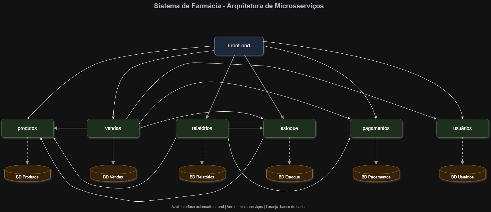

# 💊 Sistema de Farmácia — Arquitetura de Microsserviços

Sistema de gerenciamento para farmácia dividido em **6 microsserviços
independentes**, cada um com seu próprio banco de dados, comunicando-se apenas
por **HTTP/REST com JSON**.



## Equipe e serviços

| Integrante | Linguagem  | Serviços                                | Portas       |
|------------|------------|-----------------------------------------|--------------|
| Giovana    | Java       | `produto-service`, `estoque-service`    | 8002, 8003   |
| Guilherme  | Python     | `usuario-service`, `venda-service`      | 8001, —      |
| Sophia     | JavaScript | `pagamento-service`, `relatorio-service`| 3005, —      |

## Regra principal da arquitetura

Cada serviço tem código e banco próprios. Um serviço **nunca** acessa o banco
de outro — quando precisa de um dado, chama a API do dono daquele dado:

```
venda-service  ->  GET /produtos/15  ->  produto-service  ->  BD Produtos
```

e nunca `venda-service -> BD Produtos`.

## Padrão de comunicação

- HTTP + REST, dados em JSON com campos em `camelCase`;
- `200` sucesso, `201` criado, `204` sem conteúdo, `400` dados inválidos,
  `404` não encontrado, `409` conflito, `500` erro interno;
- formato único de erro:

```json
{
  "timestamp": "2026-11-22T20:15:03.114",
  "status": 404,
  "erro": "Produto nao encontrado para o id 99",
  "caminho": "/produtos/99"
}
```

## Como rodar

```bash
cp .env.example .env    # necessário na primeira vez
docker compose up --build
```

Depois acesse a interface em **http://localhost:8080**.

| Serviço             | URL local               | Banco                    |
|---------------------|-------------------------|--------------------------|
| `frontend`          | http://localhost:8080   | —                        |
| `usuario-service`   | http://localhost:8001   | Postgres `localhost:5434`|
| `produto-service`   | http://localhost:8002   | MySQL `localhost:3307`   |
| `estoque-service`   | http://localhost:8003   | MySQL `localhost:3308`   |
| `pagamento-service` | http://localhost:3005   | SQLite (volume)          |

Para subir só uma parte: `docker compose up --build produto-service estoque-service`.

### Configuração (`.env`)

O `docker compose` lê um arquivo `.env` na raiz e usa os valores para
substituir os `${...}` do `docker-compose.yml`, que por sua vez injeta as
variáveis dentro dos containers:

```
.env  →  docker compose substitui ${VAR}  →  environment:  →  container
```

Cada pessoa cria o seu com `cp .env.example .env`. **O `.env` é ignorado pelo
git de propósito** — o que se compartilha é o [`.env.example`](.env.example),
que é versionado.

| Variável | Serviço | Padrão |
|---|---|---|
| `JWT_SECRET` | usuário | **obrigatória** |
| `ADMIN_EMAIL` | usuário | **obrigatória** |
| `ADMIN_SENHA` | usuário | **obrigatória** |
| `MYSQL_ROOT_PASSWORD` | produtos, estoque | `root` |
| `MYSQL_APP_USER` | produtos, estoque | `farmacia` |
| `MYSQL_APP_PASSWORD` | produtos, estoque | `farmacia` |
| `PRODUTO_DB_PORT` | produtos | `3307` |
| `ESTOQUE_DB_PORT` | estoque | `3308` |

As variáveis dos serviços em Java têm padrão, então sobem sem configuração
nenhuma. As do `usuario-service` não têm: sem elas o serviço não inicia.

Se alguma porta der conflito na sua máquina — é comum já existir um MySQL
ocupando a `3306` — mude `PRODUTO_DB_PORT` ou `ESTOQUE_DB_PORT` no seu `.env`.
Isso muda só a porta publicada no seu computador; entre os containers a
comunicação continua na `3306`.

## Documentação de cada serviço

- [`produto-service/README.md`](produto-service/README.md) — endpoints e contratos de Produtos
- [`estoque-service/README.md`](estoque-service/README.md) — endpoints e contratos de Estoque
- [`CONTRATOS.md`](CONTRATOS.md) — **contratos de todas as APIs**, incluindo a proposta de Vendas e Relatórios
- [`frontend/README.md`](frontend/README.md) — interface web e o proxy para os serviços

## Frontend

Interface web simples em HTML, CSS e JavaScript puros, servida por nginx, que
também funciona como proxy reverso: o navegador fala só com
`localhost:8080` e o nginx encaminha cada caminho `/api/...` para o serviço
dono do dado. Assim não há CORS e o frontend não precisa conhecer a porta de
nenhum serviço.

**Todas as seis telas estão implementadas**: login, produtos, estoque, vendas,
pagamentos e relatórios. As de Vendas e Relatórios foram escritas contra o
contrato de [`CONTRATOS.md`](CONTRATOS.md); enquanto os serviços não existem,
elas mostram um aviso em vez de quebrar. Ligá-las depois é trocar dois blocos
no `nginx.conf` — nenhuma linha de JavaScript muda.

## Diagrama de classes


