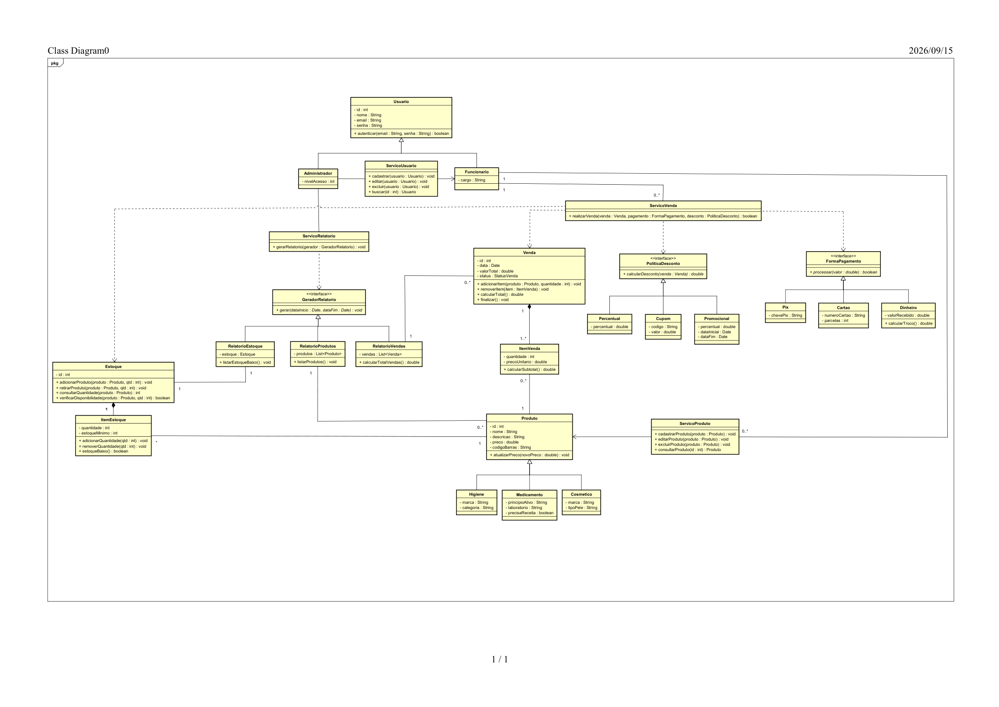

# 💊 Sistema de Farmácia — Arquitetura de Microsserviços

Sistema de gerenciamento para farmácia dividido em **6 microsserviços
independentes**, cada um com seu próprio banco de dados, comunicando-se apenas
por **HTTP/REST com JSON**.


## Equipe e serviços

| Integrante | Linguagem  | Serviços                                | Portas       |
|------------|------------|-----------------------------------------|--------------|
| Giovana    | Java       | `produto-service`, `estoque-service`    | 8002, 8003   |
| Guilherme  | Python     | `usuario-service`, `venda-service`      | 8001, —      |
| Sophia     | JavaScript | `pagamento-service`, `relatorio-service`| 3005, —      |

## Regra principal da arquitetura

Cada serviço tem código e banco próprios. Um serviço **nunca** acessa o banco
de outro — quando precisa de um dado, chama a API do dono daquele dado:

```
venda-service  ->  GET /produtos/15  ->  produto-service  ->  BD Produtos
```

e nunca `venda-service -> BD Produtos`.

## Padrão de comunicação

- HTTP + REST, dados em JSON com campos em `camelCase`;
- `200` sucesso, `201` criado, `204` sem conteúdo, `400` dados inválidos,
  `404` não encontrado, `409` conflito, `500` erro interno;
- formato único de erro:

```json
{
  "timestamp": "2026-11-22T20:15:03.114",
  "status": 404,
  "erro": "Produto nao encontrado para o id 99",
  "caminho": "/produtos/99"
}
```

## Como rodar

```bash
cp .env.example .env    # necessário na primeira vez
docker compose up --build
```

| Serviço             | URL local               | Banco                    |
|---------------------|-------------------------|--------------------------|
| `usuario-service`   | http://localhost:8001   | Postgres `localhost:5434`|
| `produto-service`   | http://localhost:8002   | Postgres `localhost:5435`|
| `estoque-service`   | http://localhost:8003   | Postgres `localhost:5436`|
| `pagamento-service` | http://localhost:3005   | SQLite (volume)          |

Para subir só uma parte: `docker compose up --build produto-service estoque-service`.

O `usuario-service` espera as variáveis `JWT_SECRET`, `ADMIN_EMAIL` e
`ADMIN_SENHA` em um arquivo `.env` na raiz — use o [`.env.example`](.env.example)
como modelo. O `.env` em si não vai para o git.

## Documentação de cada serviço

- [`produto-service/README.md`](produto-service/README.md) — endpoints e contratos de Produtos
- [`estoque-service/README.md`](estoque-service/README.md) — endpoints e contratos de Estoque

## Diagrama de classes


